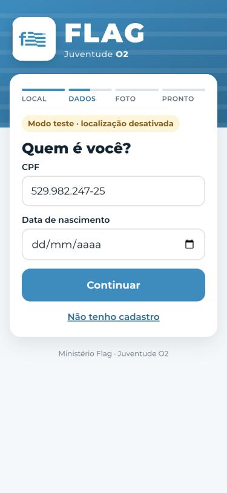
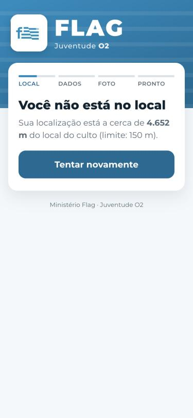
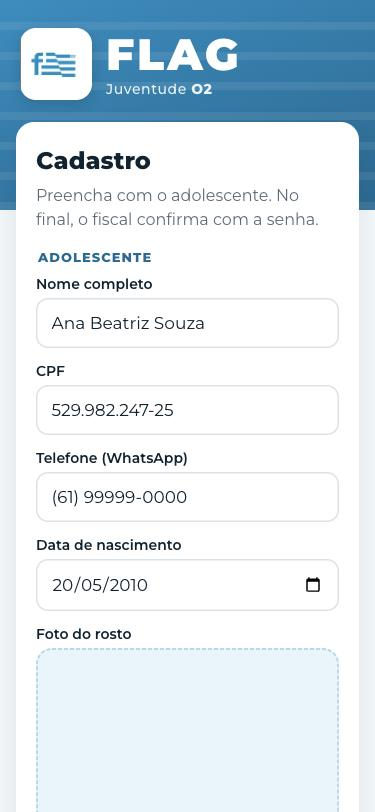
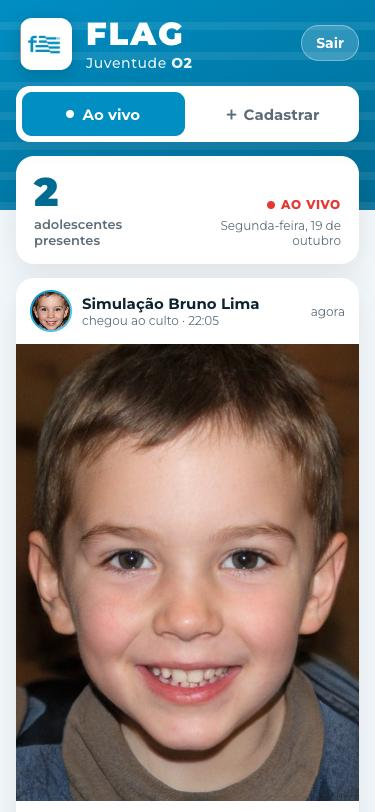
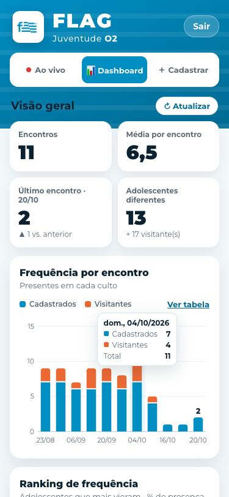
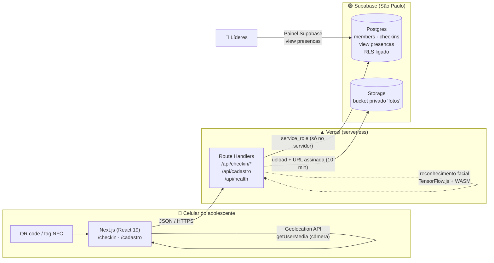
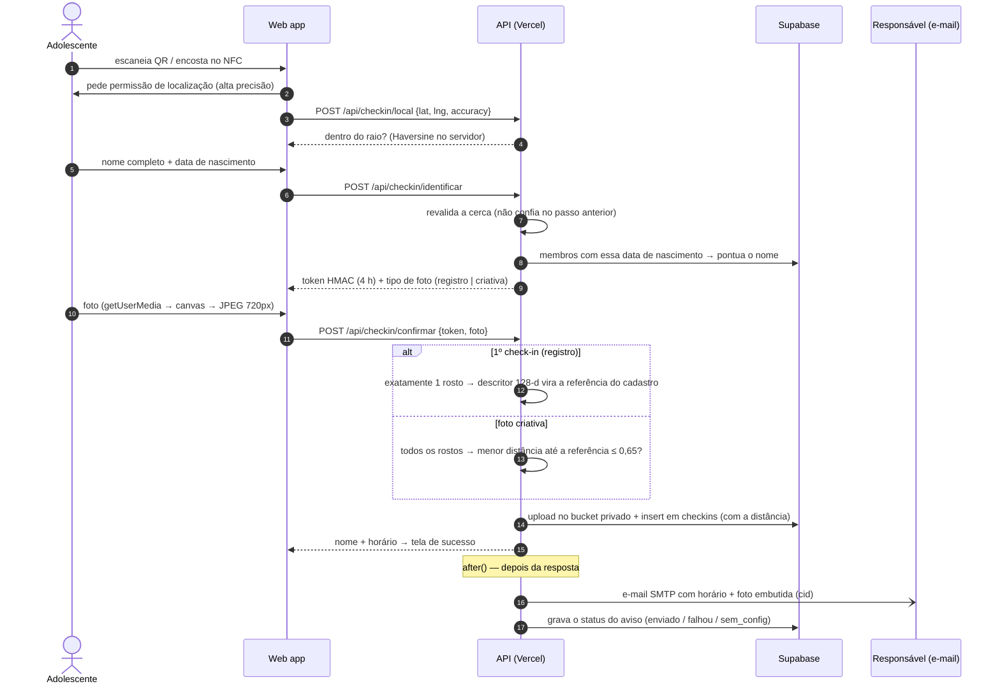

<div align="center">


# Flag Check-in

**Check-in antifraude para o ministério de adolescentes de uma igreja: QR code ou NFC → geolocalização → nome e nascimento → foto com reconhecimento facial.**

Ministério **Flag** · Juventude **O2** — Igreja Batista Capital, Brasília

[](https://github.com/pedroeduardo36/flag-checkin/actions/workflows/ci.yml)


[**▶ Abrir o app**](https://flag-checkin.vercel.app/checkin) · [QR code para imprimir](https://flag-checkin.vercel.app/qrcode) · [Guia de instalação](docs/SETUP.md)

<a href="https://flag-checkin.vercel.app/qrcode"></a><br/><sub>Aponte a câmera do celular · o check-in só é aceito no local do culto</sub>

</div>

---

## O problema

A cada culto, dezenas de adolescentes chegam ao mesmo tempo. A lista de presença no papel é lenta, fácil de fraudar
("assina por mim?") e não diz nada aos líderes sobre frequência ou sobre quem parou de vir. Os responsáveis também
querem saber se o filho chegou.

## A solução

Um **web app mobile-first**, sem instalar nada, em três momentos:

1. **Antes do culto, o responsável cadastra o filho** em [`/cadastro`](https://flag-checkin.vercel.app/cadastro): sem foto e
   sem senha, com seções separadas para os dados do adolescente e os do responsável.
2. **Na entrada:** um QR code ou tag NFC abre o check-in. O app confere a **localização** e o adolescente informa **nome
   completo e data de nascimento**. No **primeiro check-in da vida**, ele tira uma **foto de registro**, que precisa ter um
   rosto só e vira a referência do cadastro.
3. **Dentro do culto:** nos check-ins seguintes, a **foto criativa** (amigos, pose, careta) conclui o check-in. Basta um
   dos rostos da foto ser o do adolescente. A identificação da entrada fica guardada no celular por 4 h.

**Visitantes** fazem check-in só com nome e telefone, com foto criativa opcional.

| 1. Localização | 2. Nome e nascimento (ou visitante) | 3. Confirmação | Fora do raio | Cadastro pelo responsável |
| :-: | :-: | :-: | :-: | :-: |
|  |  |  |  |  |

| E-mail para o responsável | Pastor: ao vivo | Pastor: dashboard |
| :-: | :-: | :-: |
|  |  |  |

### Área do pastor — [`/pastor`](https://flag-checkin.vercel.app/pastor)

Protegida por senha, com três abas:
- **Ao vivo:** feed no estilo Instagram com quem acabou de chegar (foto do cadastro, nome, horário e foto do
  check-in), contador de presentes do dia e selos "1º check-in", "foto criativa", "visitante", "rosto confere" e
  "responsável avisado". Novos check-ins aparecem
  sozinhos, em cerca de 4 segundos, com destaque de entrada.
- **Exemplo para teste:** check-ins marcados com `is_example` aparecem sempre no fim do feed, com a etiqueta "Exemplo"
  e a data do culto. Não entram no contador do dia e as rotinas de limpeza dos testes não os apagam.
- **Dashboard:** indicadores (encontros, média por encontro, último encontro comparado ao anterior, adolescentes
  diferentes), **evolução da frequência a cada encontro** em colunas empilhadas (cadastrados e visitantes, com dica ao
  tocar e opção de tabela) e **ranking dos 10 mais frequentes**, com % de presença desde o 1º check-in e 🔥 sequência
  de encontros seguidos.
- **Cadastrar:** o mesmo formulário do responsável, com o botão "Cadastrar outro" para cadastrar em sequência.

E o responsável recebe na hora um **e-mail com o horário e a foto do check-in**.

Três fatores tornam a fraude cara:

1. **Onde você está:** cerca geográfica (*geofence*) de 150 m ao redor da igreja, validada **no servidor**.
2. **Quem você é:** nome completo e data de nascimento conferidos com o cadastro feito pelo responsável.
3. **Que é você mesmo:** a foto de registro (1º check-in) precisa ter um rosto real, e cada foto criativa depois é
   comparada por **reconhecimento facial** com ela. Se ninguém na foto for o adolescente, o check-in é recusado.

---

## Arquitetura



**Decisões e por quê**

| Decisão | Motivo |
| --- | --- |
| **Web app, não app nativo** | Ninguém instala app para entrar no culto. QR e NFC abrem uma URL, e o navegador já oferece GPS e câmera. |
| **Next.js com Route Handlers** | Front e API num repositório só, um deploy só e tipos compartilhados (`lib/format.ts` roda no cliente **e** no servidor). |
| **O navegador nunca fala com o banco** | Toda leitura e escrita passa pela API com a chave `service_role`. O banco tem RLS ligado e **nenhuma** política pública: a chave `anon` vazada não lê nada (isso foi testado). |
| **Supabase em vez de Firebase/Neon** | Postgres de verdade (constraints, views, migrations SQL) **e** armazenamento de arquivos no mesmo plano grátis. Região `sa-east-1`, perto dos usuários e alinhada à LGPD. |
| **Token HMAC sem estado entre as etapas** | A identificação (nome e nascimento, na entrada) emite um token assinado de **4 h** que a etapa da foto exige, já que a foto criativa é tirada dentro do culto. O celular guarda o token e, ao reabrir a página, vai direto para a foto. Sem sessão nem tabela extra. |
| **Busca por nome tolerante** | Filtra por data de nascimento e pontua o nome: sem acento, sem "de/da/dos", nomes do meio podem ser omitidos e uma palavra longa pode ter um erro de digitação. O primeiro nome tem de bater, e empate entre dois cadastros pede o nome completo. |
| **Foto de registro no 1º check-in, não no cadastro** | Quem cadastra é o responsável, de casa. A foto de referência é tirada pelo próprio adolescente na igreja, exigindo um rosto só, e as fotos seguintes podem ser criativas. |
| **Unicidade no banco, não no código** | `unique (member_id, service_date)` garante um check-in por dia mesmo com dois cliques simultâneos (corrida tratada pelo código `23505`). |
| **Reconhecimento facial no servidor** | face-api (TensorFlow.js) com backend **WebAssembly**: roda dentro da função serverless, sem GPU, binário nativo nem API paga. No navegador seria fácil de burlar; no servidor, a decisão é da API. |
| **Descritor guardado, não comparado na foto** | No 1º check-in é salvo um vetor de 128 números do rosto. Depois, só a foto criativa é analisada (cerca de 250 ms) e comparada com esse vetor. |
| **E-mail ao responsável com `after()`** | O envio SMTP roda **depois** da resposta (`next/server` `after`). O adolescente vê a tela de sucesso na hora, e uma falha no e-mail não desfaz o check-in. O resultado fica gravado (`enviado`, `falhou`, `sem_email`, `sem_config`) e aparece na lista de presença. |
| **Foto embutida (CID), não link** | A foto do check-in vai como anexo *inline*. Não depende de URL assinada (que expira) nem de bucket público, e aparece direto no Gmail ou Outlook. |
| **SMTP, não SDK de um fornecedor** | Nodemailer funciona com Gmail, Brevo ou Resend só trocando variáveis de ambiente. |
| **Feed "ao vivo" por *polling* incremental** | A cada 4 s a página pergunta só pelo que chegou depois do último check-in visto (`?since=`). Não precisa de WebSocket nem de Realtime, que exigiria abrir o banco para a chave pública. Pausa com a aba escondida e renova as URLs das fotos a cada 30 min. |
| **Sessão do pastor sem tabela** | O cookie `httpOnly` + `SameSite=strict` guarda `validade.assinatura` (HMAC). O servidor só confere a assinatura e o prazo de 12 h. |
| **Dashboard calculado numa função pura** | `lib/stats.ts` recebe só `(data, membro, visitante)` de cada check-in e devolve indicadores, evolução e ranking, testada sem banco. O percentual de presença conta só os encontros **desde a 1ª vez** do adolescente, para não punir quem chegou depois. |
| **Gráfico em SVG próprio, sem biblioteca** | Colunas empilhadas com um só eixo, rótulo só no maior e no último encontro, dica ao passar o dedo ou o mouse, alternativa em tabela e paleta (azul da marca + laranja) **validada por script** para daltonismo e contraste. |
| **Data do culto em `America/Sao_Paulo`** | Um culto às 22h em Brasília já é o "dia seguinte" em UTC. O fuso é explícito e coberto por teste. |

## Fluxo do check-in



O cadastro (`/cadastro`) segue o mesmo padrão: validação no cliente para dar resposta rápida e **a mesma validação
repetida no servidor**, mais um campo invisível que só robôs preenchem (*honeypot*). O visitante (`/api/checkin/visitante`)
passa pela mesma cerca geográfica e tem um check-in por telefone por dia.

### Reconhecimento facial

| Etapa | Modelo | O que faz |
| --- | --- | --- |
| Detecção | SSD MobileNet v1 | encontra os rostos e devolve a caixa e a confiança |
| Alinhamento | 68 landmarks | posiciona olhos, nariz e boca para normalizar o rosto |
| Descritor | FaceRecognitionNet (ResNet-34) | gera um vetor de 128 números por rosto |
| Comparação | distância euclidiana | foto criativa aceita se **algum** rosto estiver a ≤ **0,65** da referência (configurável em `FACE_MATCH_THRESHOLD`) |

Regras: sem rosto → recusa; um segundo rosto com mais de 50% do tamanho do principal → "mais de uma pessoa" (rostos
pequenos ao fundo são tolerados); rosto com menos de 15% da largura da foto → "aproxime o celular".

Calibração com rostos sintéticos: **0,35** para a mesma pessoa (espelhada, girada e mais escura) contra **0,76 a 0,82**
para pessoas diferentes.

---

## Design

- **Identidade a partir do logo:** o azul `#008EC3` foi tirado do logo do Flag por análise de pixels. As listras do
  cabeçalho repetem a bandeira do logo.
- **Hierarquia de marca pedida pelo ministério:** **FLAG** em destaque (900, 44px) e "Juventude **O2**" como apoio.
- **Mobile-first de verdade:** botões de 54px, inputs de 17px (abaixo de 16px o iOS dá zoom ao focar),
  `inputMode="numeric"` com máscara DD/MM/AAAA na data.
- **Uma decisão por tela** e barra de progresso em 4 etapas, para quem está na fila e com pressa.
- **Erros que dizem o que fazer:** localização negada vira um passo a passo para iPhone e Android; GPS impreciso
  sugere ligar a *Localização Precisa*; cadastro não encontrado oferece o check-in de visitante.
- **Câmera com guia oval** e *fallback* para `<input capture="user">` quando o navegador bloqueia `getUserMedia`.
- **Acessibilidade:** `role="alert"` nas mensagens de erro, `aria-label` no progresso e respeito a
  `prefers-reduced-motion`.

## Segurança e privacidade (dados de menores)

| Ameaça | Mitigação |
| --- | --- |
| Check-in de casa | Cerca geográfica validada **no servidor**, duas vezes. A foto fica como prova para auditoria. |
| "Faz o check-in por mim" | A foto criativa é comparada com a foto de registro (403 se ninguém na foto for o adolescente). A distância fica gravada para auditoria. |
| Injeção de HTML no e-mail | Nome e responsável vêm do cadastro e são escapados antes de entrar no HTML (teste cobre `<b>`). |
| Acesso ao feed (fotos de menores) | Senha do pastor conferida no servidor. O cookie de sessão é `httpOnly`, `SameSite=strict` e assinado; cookie forjado ou vencido recebe 401. A página não é indexada (`robots: noindex`). |
| Força bruta na senha do pastor | Comparação em tempo constante e atraso de 0,8 s a cada senha errada. |
| Foto de registro de qualquer coisa | A foto do 1º check-in precisa ter exatamente um rosto, de perto, verificado no servidor. |
| Descobrir quem está cadastrado | Nome inexistente e data errada recebem **a mesma** resposta (sem *user enumeration*). |
| Pular a etapa de identificação | A foto só é aceita com um token HMAC-SHA256 válido (4 h), comparado em tempo constante. |
| Cadastro aberto (sem senha) | CPF único, validação completa no servidor e *honeypot* contra robôs. Mesmo um cadastro falso não faz check-in sem estar na igreja e sem um rosto real na foto de registro. |
| Vazamento de chave pública | RLS sem políticas: a chave `anon` não lê nem grava nada (teste: `[]` e `401`). |
| Fotos expostas | Bucket **privado**, com limite de 2 MB e só MIME de imagem. Acesso por URL assinada de 10 minutos. |
| Upload malicioso | `decodePhoto` aceita apenas `data:image/jpeg;base64` entre 2 KB e 2 MB, decodificado por um leitor JPEG em JavaScript puro. |
| Segredo no cliente | `import "server-only"` em `lib/server/*`: o build falha se algo do servidor for importado no navegador. |
| LGPD (art. 14, menores) | Consentimento do responsável obrigatório e gravado com data (`guardian_consent_at`), e coleta mínima. |

Também foram adicionados os cabeçalhos `Permissions-Policy` (câmera e GPS só na própria origem),
`X-Content-Type-Options` e `Referrer-Policy`.

**Limitações assumidas:** apps de GPS falso existem, e por isso a foto é a segunda camada. O reconhecimento facial não
tem prova de vida (*liveness*): mostrar uma foto impressa da pessoa para a câmera ainda passaria. O próximo passo seria
pedir um movimento, como piscar ou virar o rosto. Ainda não há limite de
tentativas por IP; o próximo passo seria o Upstash Ratelimit nas rotas de identificação.

## Testes

```bash
npm test             # 56 testes unitários (Vitest): dashboard, busca por nome, máscaras, datas, Haversine, HMAC, geofence, upload, rostos (registro e criativa), e-mail, sessão do pastor
npm run typecheck    # TypeScript em modo strict
npm run test:fluxo   # 40 verificações ponta a ponta contra o Supabase real, com limpeza dos dados no final
npm run simular      # dois adolescentes sintéticos fazem check-in com 8 s de intervalo (para ver o feed ao vivo)
```

O **teste ponta a ponta** cobre o caminho feliz **e** os ataques: cadastro pelo responsável sem foto nem senha, CPF
duplicado (409), posição fora do raio (403), nome ou data errados (404), identificação com o nome sem acento e sem o
nome do meio, **foto de registro** sem rosto ou com duas pessoas (422), segundo check-in no mesmo dia (409), **foto
criativa** de outra pessoa (403) e **em grupo com o adolescente** (200), visitante com e sem foto e repetido no dia,
área do pastor (401, cookie `httpOnly`, feed com visitantes) e a view de presença.

As imagens de teste em `tests/fixtures/` são **rostos sintéticos** gerados por StyleGAN2 (thispersondoesnotexist.com):
nenhuma pessoa real aparece no repositório.

A esteira de **CI no GitHub Actions** roda tipos, testes e build a cada push e PR.

## Stack

**Front:** Next.js 15 (App Router) · React 19 · TypeScript strict · CSS puro com design tokens (sem framework de UI)
**Back:** Route Handlers serverless · `node:crypto` (HMAC e comparação em tempo constante) · Supabase JS
**E-mail:** Nodemailer (SMTP) · HTML responsivo em tabelas (compatível com Gmail e Outlook) · imagem inline via CID
**Visão computacional:** face-api (TensorFlow.js 4, backend WebAssembly) · SSD MobileNet v1 · FaceRecognitionNet · jpeg-js
**Dados:** Postgres 17 (Supabase) · migrations versionadas com o Supabase CLI · Storage privado
**Infra:** Vercel · GitHub Actions · QR code gerado no servidor (`/api/qrcode`) · tags NFC NTAG213

## Estrutura

```
app/
  checkin/page.tsx            check-in (local → nome e nascimento ou visitante → foto de registro ou criativa → sucesso)
  cadastro/page.tsx           cadastro pelo responsável (sem foto, sem senha) com consentimento LGPD
  pastor/page.tsx             área do pastor: login, feed ao vivo estilo Instagram e cadastro
  api/checkin/local           GET: modo teste? · POST: confere a cerca
  api/checkin/identificar     nome + nascimento → token HMAC (4 h) e tipo de foto
  api/checkin/confirmar       foto de registro (1º) ou criativa → Storage + insert + e-mail
  api/checkin/visitante       visitante: nome + telefone (+ foto opcional)
  api/cadastro                novo adolescente
  api/pastor/sessao           login (POST), sessão (GET) e saída (DELETE) do pastor
  api/pastor/dashboard        indicadores, evolução por encontro e ranking (só com a sessão do pastor)
  api/pastor/feed             check-ins do dia com URLs assinadas das fotos (?since= para o incremental)
  api/health                  diagnóstico (variáveis, tabelas, view e bucket)
  api/qrcode · qrcode/        QR code gerado no servidor (PNG/SVG) e página para imprimir
components/                   Brand (marca), Camera (getUserMedia + fallback), CadastroForm (responsável | pastor), PastorDashboard (indicadores, gráfico SVG, ranking)
lib/stats.ts                  cálculo do dashboard (função pura)
lib/format.ts                 validações compartilhadas cliente/servidor
lib/server/                   env, cliente Supabase, segurança, reconhecimento facial, tratamento de erros
supabase/migrations/          schema, RLS, view de presença e bucket
scripts/                      gerador de QR code e teste ponta a ponta
tests/                        testes unitários (Vitest) e rostos sintéticos de teste
```

## Rodando localmente

```bash
git clone https://github.com/pedroeduardo36/flag-checkin.git && cd flag-checkin
npm install
cp .env.example .env.local     # preencha com seu projeto Supabase
npx supabase link --project-ref SEU_REF && npm run db:push
npm run dev
```

O passo a passo completo (Supabase, Vercel, QR code, NFC e operação no dia do culto) está em
[docs/SETUP.md](docs/SETUP.md).

---

<div align="center">
Feito por <a href="https://github.com/pedroeduardo36">Pedro Andrade</a> para o Ministério Flag · Juventude O2
</div>
