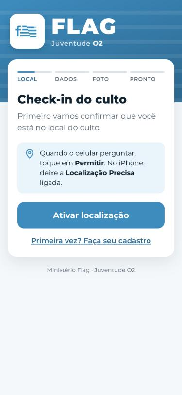
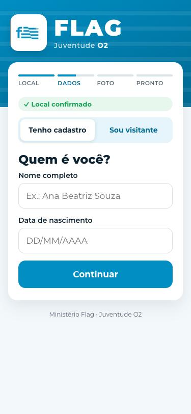
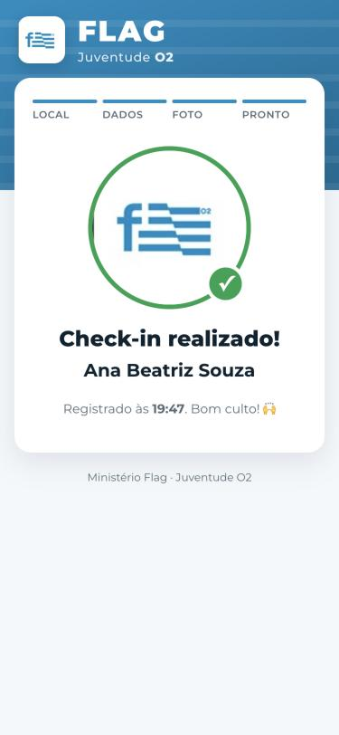
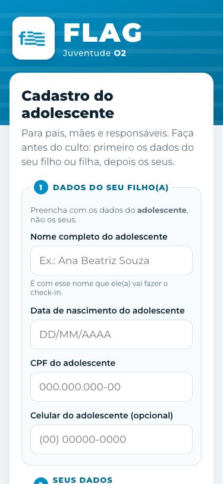
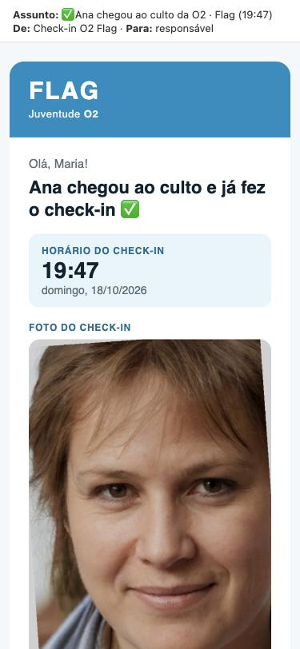
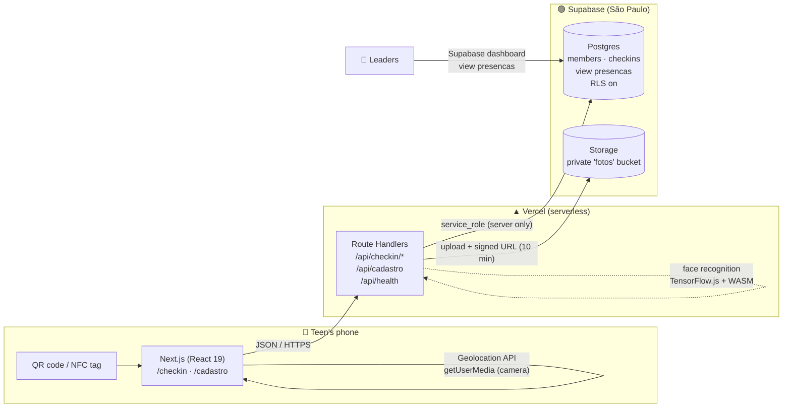
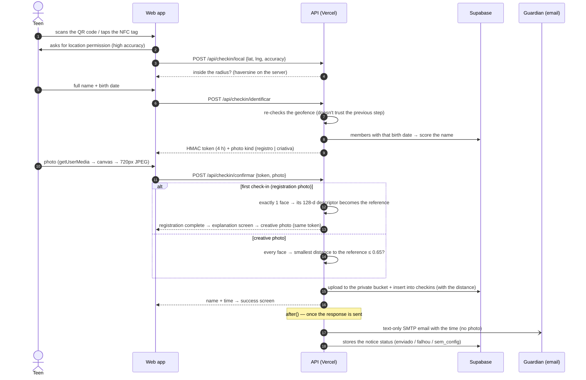

<div align="center">


# Flag Check-in

**Fraud-resistant check-in for a church youth ministry: QR code or NFC → geolocation → name and birth date → photo with face recognition.**

**Flag** ministry · **O2** youth group, Igreja Batista Capital, Brasília (Brazil)

[](https://github.com/pedroeduardo36/flag-checkin/actions/workflows/ci.yml)


[**▶ Open the app**](https://flag-checkin.vercel.app/checkin) · [Printable QR code](https://flag-checkin.vercel.app/qrcode) · [Setup guide](docs/SETUP.md)

<a href="https://flag-checkin.vercel.app/qrcode"></a><br/><sub>Point your phone camera at it · check-in is only accepted at the service venue</sub>

</div>

---

> **Language note.** The code, tests and docs are in English. The app itself is in Brazilian Portuguese because its
> users are Brazilian teens, parents and youth leaders. Routes (`/cadastro`, `/pastor`, `/api/lider/*`), database
> objects (`presencas`, `expurgar_dados()`), stored values (audit actions, email statuses) and API error codes keep their
> Portuguese names so printed QR codes, sent links and the production database keep working.
> [Glossary](#glossary) below.

## The problem

At every service, dozens of teens arrive at the same time. A paper attendance sheet is slow, easy to fake ("can you
sign for me?") and tells leaders nothing about attendance trends or who stopped coming. Parents also want to know
their kid arrived.

## The solution

A **mobile-first web app**, with nothing to install, built around three moments:

1. **Before the service, the guardian registers the teen** at [`/cadastro`](https://flag-checkin.vercel.app/cadastro):
   no photo and no password, with separate sections for the teen's and the guardian's details, and up to **two emails**
   for notices (the second is optional). Before submitting, they read how face recognition works and tick **two
   consents** (the general one and the specific one for biometrics). Then they get a **confirmation link**: check-in
   only starts working once the email owner opens it and confirms ([privacy](docs/privacy/README.md)).
2. **At the entrance:** a QR code or NFC tag opens the check-in. The app checks the **location**, and the teen enters
   their **full name and birth date**. On their **first check-in ever**, they take a **registration photo**, which must
   contain a single face and becomes the registration's reference, followed by a quick explanation of the creative photo.
3. **During the service:** the **creative photo** (friends, poses, funny faces) completes the check-in, including the
   first one. One of the faces just has to be the teen's. The identification from the entrance is kept on the phone for 4 h.

**Visitors** check in with just a name and phone number, with an optional creative photo.

| 1. Location | 2. Name and birth date (or visitor) | 3. Confirmation | Outside the radius | Registration by the guardian |
| :-: | :-: | :-: | :-: | :-: |
|  |  |  |  |  |

| Guardian email | Pastor: live feed | Pastor: dashboard |
| :-: | :-: | :-: |
|  |  |  |

### Pastor area — [`/pastor`](https://flag-checkin.vercel.app/pastor)

Each leader signs in with **their own account: password + authenticator app code** (see Security). Four tabs:
- **Live:** an Instagram-style feed of who just arrived (registration photo, name, time and check-in photo), the day's
  head count, and "first check-in", "creative photo", "visitor", "face matches", "guardian notified"
  badges. New check-ins show up on their own within about 4 seconds, highlighted as they arrive.
- **Test example:** check-ins flagged `is_example` always appear at the end of the feed, tagged "Exemplo" with the
  service date. They don't count toward the day's total, and test cleanup never deletes them.
- **Dashboard:** KPIs (services, average per service, latest service vs. the previous one, unique teens), the **attendance trend per service** as stacked columns (registered teens and visitors, with tap tooltips
  and a table view) and a **top-10 attendance ranking**, with the % of services attended since the first check-in and a
  🔥 streak of consecutive services.
- **Register:** the guardian's form, with a "register another" button for back-to-back registrations.
- **Leaders:** leader accounts, sessions, the action log, possible duplicates and family privacy requests.

The guardian gets an instant **text-only** notice **at the confirmed emails** with the time. The creative photo may show
other teens, so it never leaves the app.

Three factors make fraud expensive:

1. **Where you are:** a 150 m geofence around the church, validated **on the server**.
2. **Who you are:** full name and birth date matched against the guardian's registration.
3. **That it's really you:** the registration photo (first check-in) must show a real face, and every later creative
   photo is compared with it through **face recognition**. If nobody in the photo is the teen, the check-in is rejected.

---

## Architecture



**Decisions and why**

| Decision | Reason |
| --- | --- |
| **Web app, not a native app** | Nobody installs an app to walk into a service. QR and NFC open a URL, and the browser already provides GPS and the camera. |
| **Next.js with Route Handlers** | Frontend and API in one repository, one deploy and shared types (`lib/format.ts` runs on the client **and** the server). |
| **The browser never talks to the database** | Every read and write goes through the API with the `service_role` key. The database has RLS on and **no** public policies: a leaked `anon` key reads nothing (tested). |
| **Supabase instead of Firebase/Neon** | Real Postgres (constraints, views, SQL migrations) **and** file storage on the same free plan. Region `sa-east-1`, close to the users and in line with LGPD (Brazil's data protection law). |
| **Stateless HMAC token between steps** | Identification (name and birth date, at the entrance) issues a **4 h** signed token that the photo step requires, since the creative photo is taken during the service. The phone keeps the token and, when the page is reopened, goes straight to the photo. No session or extra table. |
| **Forgiving name search** | Filters by birth date and scores the name: accents and "de/da/dos" particles are ignored, middle names can be left out and one long word may have a typo. The first name must match, and a tie between two registrations asks for the full name. |
| **Registration photo at the first check-in, not at registration** | The guardian registers from home. The teen takes the reference photo at church, with a single face required, and later photos can be creative. |
| **Uniqueness in the database, not in code** | `unique (member_id, service_date)` guarantees one check-in per day even with two simultaneous taps (the race is handled through error code `23505`). |
| **Face recognition on the server** | face-api (TensorFlow.js) with the **WebAssembly** backend runs inside the serverless function: no GPU, native binary or paid API. In the browser it would be easy to bypass; on the server, the API decides. |
| **Stored descriptor, not a photo-to-photo comparison** | The first check-in saves a 128-number face vector. After that, only the creative photo is analyzed (about 250 ms) and compared with that vector. |
| **Guardian email with `after()`** | SMTP runs **after** the response (`next/server` `after`). The teen sees the success screen immediately, and an email failure never undoes the check-in. The result is stored (`enviado`, `falhou`, `sem_email`, `sem_config`) and shows in the attendance list. |
| **Text-only notices** | The check-in email carries only the name and time. The creative photo may show other minors, so it stays inside the app, behind leader sign-in, and is deleted after 30 days. |
| **SMTP, not a vendor SDK** | Nodemailer works with Gmail, Brevo or Resend by swapping environment variables. |
| **"Live" feed through incremental polling** | Every 4 s the page asks only for what arrived after the last check-in seen (`?since=`). No WebSocket and no Realtime, which would require opening the database to the public key. It pauses while the tab is hidden and refreshes photo URLs every 30 min. |
| **Leader session in the database, not just the cookie** | The `httpOnly` + `SameSite=strict` cookie carries 32 random bytes; the database stores the hash. Deactivating an account or ending sessions takes effect immediately, on any instance. Every login stage (password → code → access) rotates the cookie value. |
| **Dependency-free TOTP** | RFC 6238 in ~60 lines of `node:crypto`, tested against the official RFC vectors. The secret is encrypted (AES-256-GCM) in the database and the last accepted step is stored, so the same code never works twice. |
| **Attempt limits in Postgres** | `insert … on conflict do update returning hits` locks the row: 14 simultaneous requests count as 14, even across serverless functions. The attempt is counted **before** the password is checked. |
| **Dashboard computed in a pure function** | `lib/stats.ts` takes only `(date, member, visitor)` per check-in and returns KPIs, trend and ranking, tested without a database. The attendance percentage counts only services **since the teen's first time**, so newcomers aren't penalized. |
| **Hand-rolled SVG chart, no library** | Stacked columns with a single axis, labels only on the largest and the latest service, touch/mouse tooltips, a table alternative and a palette (brand blue + orange) **validated by a script** for color blindness and contrast. |
| **Service date in `America/Sao_Paulo`** | A 10 pm service in Brasília is already "tomorrow" in UTC. The time zone is explicit and covered by tests. |

## Check-in flow



Registration (`/cadastro`) follows the same pattern: client-side validation for quick feedback and **the same
validation repeated on the server**, plus an invisible field only bots fill in (*honeypot*). Visitors
(`/api/checkin/visitante`) go through the same geofence and get one check-in per phone number per day.

### Face recognition

| Stage | Model | What it does |
| --- | --- | --- |
| Detection | SSD MobileNet v1 | finds the faces and returns the box and confidence |
| Alignment | 68 landmarks | places eyes, nose and mouth to normalize the face |
| Descriptor | FaceRecognitionNet (ResNet-34) | produces a 128-number vector per face |
| Comparison | Euclidean distance | a creative photo passes if **any** face is within **0.65** of the reference (configurable through `FACE_MATCH_THRESHOLD`) |

Rules: no face → rejected; a second face larger than 50% of the main one → "more than one person" (small faces in the
background are tolerated); a face narrower than 15% of the photo width → "move the phone closer".

Calibration with synthetic faces: **0.35** for the same person (mirrored, rotated and darker) versus **0.76 to 0.82**
for different people.

---

## Design

- **Identity drawn from the logo:** the `#008EC3` blue was sampled from the Flag logo. The header stripes echo the
  flag in the logo.
- **Brand hierarchy requested by the ministry:** **FLAG** up front (900, 44px) with "Juventude **O2**" as the supporting line.
- **Truly mobile-first:** 54px buttons, 17px inputs (iOS zooms in on focus below 16px), `inputMode="numeric"` with a
  DD/MM/YYYY mask on the date.
- **One decision per screen** and a 4-step progress bar, for people standing in line in a hurry.
- **Errors that say what to do:** denied location becomes a step-by-step guide for iPhone and Android; imprecise GPS
  suggests turning on *Precise Location*; an unknown registration offers the visitor check-in.
- **Camera with an oval guide** and a fallback to `<input capture="user">` when the browser blocks `getUserMedia`.
- **Accessibility:** `role="alert"` on error messages, `aria-label` on the progress bar and support for
  `prefers-reduced-motion`.

## Security and privacy (minors' data)

| Threat | Mitigation |
| --- | --- |
| Checking in from home | Geofence validated **on the server**, twice. The photo stays as evidence for audits. |
| "Check in for me" | The creative photo is compared with the registration photo (403 if nobody in it is the teen). The distance is stored for audits. |
| HTML injection in emails | Teen and guardian names come from the registration and are escaped before going into the HTML (a test covers `<b>`). |
| Access to the feed and dashboard (**P1 fixed**, [report](docs/security/P1-leader-accounts.md)) | **One account per leader**: password (scrypt) **and** an authenticator app code (TOTP), required before any private data. No SMS or email fallback. Sessions live in the database and can be revoked instantly. The page isn't indexed (`robots: noindex`). |
| Lost leader phone | 10 single-use **recovery codes** (only their hash is stored); using one ends the other sessions and requires enrolling a new authenticator. Without codes, **another leader** resets access and hands over a 24 h activation code in person. |
| Brute force and parallel guessing | Database-backed limits, counted before checking: 8 passwords per account and 30 per network every 15 min; 5 codes per account every 15 min and 20 per day. Holds under simultaneous requests and multiple instances. |
| Tracing leader actions | `admin_audit` table: login, creation, deactivation, ended sessions, authenticator enrollment, recovery, reset and **attendance corrections** (who, target, when, outcome, reason). A Postgres trigger refuses updates and deletes, even with the server key. Passwords, codes and biometric data never go in. |
| Registration photo of anything | The first check-in photo must contain exactly one face, close up, verified on the server. |
| Seeing another teen's photo or time (**P0 fixed**, [report](docs/security/P0-attendance-photos.md)) | Name, birth date and coordinates do **not** authorize reading private data. Photo and time only go back to the device holding the **visit session** (an `httpOnly` HMAC cookie tied to the teen and the day, issued after the face matched) or to signed-in leaders. The public response is identical whether or not the teen has checked in. |
| Investigating abuse later | `audit_events` table with every identification and confirmation (outcome, teen, IP as an HMAC, distance), because the free Vercel and Supabase plans barely keep logs. |
| Discovering who is registered | An unknown name and a wrong date get **the same** response (no user enumeration). |
| Skipping the identification step | The photo is only accepted with a valid HMAC-SHA256 token (4 h), compared in constant time. |
| Open registration (no password) | Full server-side validation and a honeypot against bots. **No CPF** (Brazilian tax ID, [report](docs/security/P1-cpf-removal.md)): a similar registration (same birth date and a compatible name) is flagged as a **possible duplicate** for a leader to merge or dismiss. The same guardian resubmitting doesn't create a duplicate and gets the same response as a new registration, so the form doesn't reveal who is registered. Even a fake registration can't check in without being at church and showing a real face in the registration photo. |
| Leaked public key | RLS without policies: the `anon` key can't read or write anything (tested: `[]` and `401`). |
| Exposed photos | **Private** bucket, 2 MB limit, image MIME types only. Access through 10-minute signed URLs. |
| Malicious upload | `decodePhoto` only accepts `data:image/jpeg;base64` between 2 KB and 2 MB, decoded by a pure-JavaScript JPEG reader. |
| Secrets on the client | `import "server-only"` in `lib/server/*`: the build fails if server code is imported in the browser. |
| LGPD (art. 11 and 14, minors and biometrics) (**P1**, [report](docs/privacy/README.md)) | General and **biometric-specific** consent, confirmed by the email owner through a single-use link, with the text version stored. A plain-language [`/privacidade`](https://flag-checkin.vercel.app/privacidade) page. Retention periods applied daily (`expurgar_dados()`), only the distance (not coordinates) stored, text-only guardian notices, family requests handled from the Leaders tab. |

The `Permissions-Policy` (camera and GPS on the app's own origin only), `X-Content-Type-Options` and `Referrer-Policy`
headers are also set.

**Known limitations:** GPS spoofing apps exist, which is why the photo is the second layer. Face recognition has no
liveness check: holding a printed photo of the person up to the camera would still pass. The next step would be asking
for a movement, such as blinking or turning the head. The public identification routes have no per-IP rate limit yet;
the next step would be Upstash Ratelimit there.

## Tests

```bash
npm test             # 86 unit tests (Vitest): dashboard, name search, masks, dates, haversine, HMAC, geofence, upload, faces, email, TOTP (RFC 6238 vectors), passwords, sessions, possible duplicates, guardian consent
npm run typecheck    # TypeScript in strict mode
npm run test:e2e     # end-to-end checks (including the P0, leader accounts, CPF removal and privacy regressions) against the real Supabase project, cleaning up the data at the end
npm run simulate     # two synthetic teens check in 8 s apart (to watch the live feed)
```

The **end-to-end test** covers the happy path **and** the attacks: registration by the guardian without photo, password
or CPF (the server discards a CPF if sent), resubmission without duplicates, a possible duplicate reviewed and merged by
a leader, a position outside the radius (403), a wrong name or date (404), identification with the name without accents
and without the middle name, a **registration photo** without a face or with two people (422), a second check-in on the
same day (409), a **creative photo** of someone else (403) and a **group photo with the teen** (200), visitors with and
without a photo and repeated on the same day, leader accounts (activation, mandatory authenticator, reused code, recovery, simultaneous bursts,
deactivation that only signs out that leader, a teen session without leader access, an immutable audit trail without
secrets), the feed with visitors and the attendance view.

The test images in `tests/fixtures/` are **synthetic faces** generated by StyleGAN2 (thispersondoesnotexist.com): no
real person appears in the repository.

The **GitHub Actions CI** pipeline runs type checks, tests and the build on every push and PR.

## Stack

**Frontend:** Next.js 15 (App Router) · React 19 · strict TypeScript · plain CSS with design tokens (no UI framework)
**Backend:** serverless Route Handlers · `node:crypto` (HMAC and constant-time comparison) · Supabase JS
**Email:** Nodemailer (SMTP) · responsive table-based HTML (works in Gmail and Outlook) · text-only notices
**Computer vision:** face-api (TensorFlow.js 4, WebAssembly backend) · SSD MobileNet v1 · FaceRecognitionNet · jpeg-js
**Data:** Postgres 17 (Supabase) · versioned migrations with the Supabase CLI · private Storage
**Infra:** Vercel (with Vercel Cron) · GitHub Actions · server-generated QR codes (`/api/qrcode`) · NTAG213 NFC tags

## Project structure

```
app/
  checkin/page.tsx            check-in (location → name and birth date or visitor → registration or creative photo → success)
  cadastro/page.tsx           registration by the guardian (no photo, no password) with LGPD consent
  confirmar/page.tsx          email link: the guardian reads, consents (or declines) and the registration becomes valid
  privacidade/page.tsx        explanation for families and teens
  pastor/page.tsx             leader area: 2-step login, live feed, dashboard, registration and Leaders tab
  api/checkin/local           GET: test mode? · POST: checks the geofence
  api/checkin/identificar     name + birth date → HMAC token (4 h) and photo kind
  api/checkin/confirmar       registration (first) or creative photo → Storage + insert + text-only notice
  api/checkin/visitante       visitor: name + phone (+ optional photo)
  api/cadastro                new teen (+ confirmation link)
  api/cadastro/verificar      confirmation or refusal by the guardian
  api/cron/retencao           retention periods (Vercel Cron, daily)
  api/lider/*                 sign in, verify (code or recovery), activate, authenticator, session, accounts, audit, duplicates, family requests
  api/pastor/checkins         attendance correction (DELETE with a reason, goes to the audit log)
  api/pastor/dashboard        KPIs, per-service trend and ranking (full leader session only)
  api/pastor/feed             the day's check-ins with signed photo URLs (?since= for incremental updates)
  api/health                  diagnostics (variables, tables, view and bucket)
  api/qrcode · qrcode/        server-generated QR code (PNG/SVG) and a printable page
components/                   Brand, Camera, RegistrationForm, PastorDashboard, LeaderAuth (login, activation, authenticator), LeadersAdmin (accounts, audit, requests)
lib/stats.ts                  dashboard calculation (pure function)
lib/format.ts                 validation shared by client and server
lib/server/                   env, Supabase client, security, face recognition, email, guardian consent, leader sessions, retention
supabase/migrations/          schema, RLS, attendance view, bucket and retention function
scripts/                      QR code generator, leader bootstrap, retention, simulations and the end-to-end test
tests/                        unit tests (Vitest) and synthetic test faces
```

## Glossary

Portuguese names that stay in routes, the database and the UI:

| Name | Meaning |
| --- | --- |
| `cadastro` | registration (of a teen) |
| `responsável` | guardian (parent or legal guardian) |
| `líder` / `pastor` | leader / pastor (the leader area lives at `/pastor`) |
| `culto` | church service |
| `presença`, view `presencas` | attendance, the attendance view |
| `visitante` | visitor |
| `foto de registro` / `foto criativa` | registration photo (reference face) / creative photo (any later check-in photo) |
| `identificar` / `confirmar` | identify (name + birth date) / confirm (photo) |
| `expurgar_dados()` | retention purge |
| `enviado`, `falhou`, `sem_email`, `sem_config` | email status: sent, failed, no email, SMTP not configured |

## Running locally

```bash
git clone https://github.com/pedroeduardo36/flag-checkin.git && cd flag-checkin
npm install
cp .env.example .env.local     # fill in your Supabase project
npx supabase link --project-ref YOUR_REF && npm run db:push
npm run dev
```

The full walkthrough (Supabase, Vercel, QR code, NFC and running it on service day) is in
[docs/SETUP.md](docs/SETUP.md).

---

<div align="center">
Built by <a href="https://github.com/pedroeduardo36">Pedro Andrade</a> for the Flag ministry · O2 youth group
</div>
