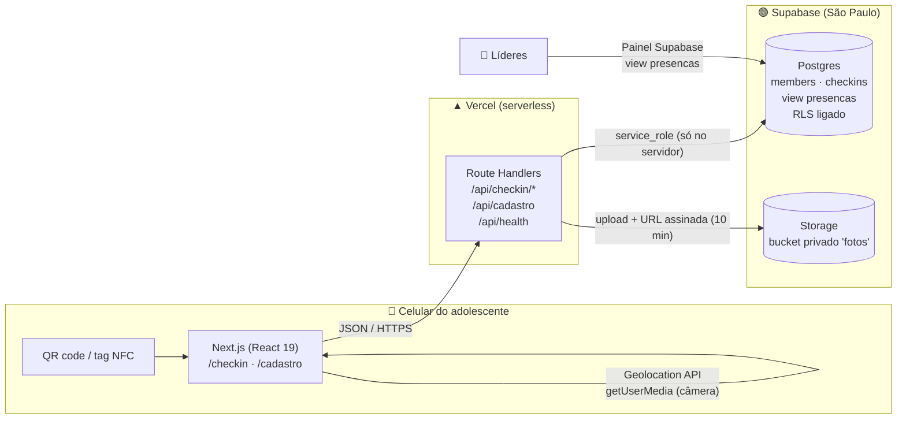
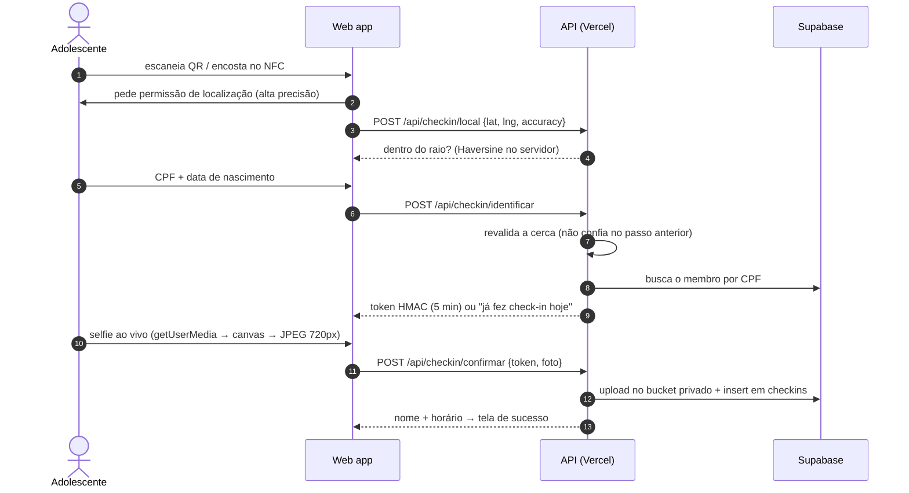

<div align="center">


# Flag Check-in

**Check-in antifraude para o ministério de adolescentes de uma igreja: QR code ou NFC → geolocalização → CPF → selfie.**

Ministério **Flag** · Juventude **O2** — Igreja Batista Capital, Brasília

[](https://github.com/pedroeduardo36/flag-checkin/actions/workflows/ci.yml)


[**▶ Abrir o app**](https://flag-checkin.vercel.app/checkin) · [Guia de instalação](docs/SETUP.md)

<br/><sub>Aponte a câmera do celular · em modo teste (sem exigir estar na igreja)</sub>

</div>

---

## O problema

A cada culto, dezenas de adolescentes chegam ao mesmo tempo. A lista de presença no papel é lenta, fácil de fraudar
("assina por mim?") e não diz nada aos líderes sobre frequência ou sobre quem parou de vir. Os responsáveis também
querem saber se o filho chegou.

## A solução

Um **web app mobile-first**, sem instalar nada. Na porta há um QR code e uma tag NFC. O adolescente encosta o
celular e o check-in leva cerca de 15 segundos:

| 1. Localização | 2. Identificação | 3. Confirmação | Fora do raio | Cadastro |
| :-: | :-: | :-: | :-: | :-: |
|  |  |  |  |  |

Três fatores tornam a fraude cara:

1. **Onde você está:** cerca geográfica (*geofence*) de 150 m ao redor da igreja, validada **no servidor**.
2. **Quem você é:** CPF e data de nascimento conferidos com o cadastro.
3. **Que é você mesmo:** selfie tirada **ao vivo** pela câmera frontal (não aceita foto da galeria) e guardada junto
   com o check-in, para o líder comparar com a foto do cadastro.

---

## Arquitetura



**Decisões e por quê**

| Decisão | Motivo |
| --- | --- |
| **Web app, não app nativo** | Ninguém instala app para entrar no culto. QR e NFC abrem uma URL, e o navegador já oferece GPS e câmera. |
| **Next.js com Route Handlers** | Front e API num repositório só, um deploy só e tipos compartilhados (`lib/format.ts` roda no cliente **e** no servidor). |
| **O navegador nunca fala com o banco** | Toda leitura e escrita passa pela API com a chave `service_role`. O banco tem RLS ligado e **nenhuma** política pública: a chave `anon` vazada não lê nada (isso foi testado). |
| **Supabase em vez de Firebase/Neon** | Postgres de verdade (constraints, views, migrations SQL) **e** armazenamento de arquivos no mesmo plano grátis. Região `sa-east-1`, perto dos usuários e alinhada à LGPD. |
| **Token HMAC sem estado entre as etapas** | A etapa "CPF ok" emite um token assinado de 5 minutos que a etapa "selfie" exige. Assim não há sessão, cookie nem tabela extra, e cabe bem num ambiente serverless. |
| **Unicidade no banco, não no código** | `unique (member_id, service_date)` garante um check-in por dia mesmo com dois cliques simultâneos (corrida tratada pelo código `23505`). |
| **Data do culto em `America/Sao_Paulo`** | Um culto às 22h em Brasília já é o "dia seguinte" em UTC. O fuso é explícito e coberto por teste. |

## Fluxo do check-in



O cadastro (`/cadastro`) segue o mesmo padrão: validação no cliente para dar resposta rápida, **a mesma validação
repetida no servidor**, e liberação só com a **senha do fiscal** do ministério.

---

## Design

- **Identidade a partir do logo:** o azul `#008EC3` foi tirado do logo do Flag por análise de pixels. As listras do
  cabeçalho repetem a bandeira do logo.
- **Hierarquia de marca pedida pelo ministério:** **FLAG** em destaque (900, 44px) e "Juventude **O2**" como apoio.
- **Mobile-first de verdade:** botões de 54px, inputs de 17px (abaixo de 16px o iOS dá zoom ao focar),
  `inputMode="numeric"` no CPF e `type="date"` nativo para a data.
- **Uma decisão por tela** e barra de progresso em 4 etapas, para quem está na fila e com pressa.
- **Erros que dizem o que fazer:** localização negada vira um passo a passo para iPhone e Android; GPS impreciso
  sugere ligar a *Localização Precisa*; CPF não encontrado oferece o link do cadastro.
- **Câmera com guia oval** e *fallback* para `<input capture="user">` quando o navegador bloqueia `getUserMedia`.
- **Acessibilidade:** `role="alert"` nas mensagens de erro, `aria-label` no progresso e respeito a
  `prefers-reduced-motion`.

## Segurança e privacidade (dados de menores)

| Ameaça | Mitigação |
| --- | --- |
| Check-in de casa | Cerca geográfica validada **no servidor**, duas vezes. A selfie fica como prova para auditoria. |
| "Faz o check-in por mim" | Selfie ao vivo exigida e guardada junto com o check-in. |
| Descobrir quem está cadastrado | CPF inexistente e data errada recebem **a mesma** resposta (sem *user enumeration*). |
| Pular a etapa de identificação | A selfie só é aceita com um token HMAC-SHA256 válido, de 5 minutos e comparado em tempo constante. |
| Cadastro por terceiros | Senha do fiscal conferida no servidor com `timingSafeEqual`. |
| Vazamento de chave pública | RLS sem políticas: a chave `anon` não lê nem grava nada (teste: `[]` e `401`). |
| Fotos expostas | Bucket **privado**, com limite de 2 MB e só MIME de imagem. Acesso por URL assinada de 10 minutos. |
| Upload malicioso | `decodePhoto` aceita apenas `data:image/(jpeg|png|webp);base64` entre 2 KB e 2 MB. |
| Segredo no cliente | `import "server-only"` em `lib/server/*`: o build falha se algo do servidor for importado no navegador. |
| LGPD (art. 14, menores) | Consentimento do responsável obrigatório e gravado com data (`guardian_consent_at`), e coleta mínima. |

Também foram adicionados os cabeçalhos `Permissions-Policy` (câmera e GPS só na própria origem),
`X-Content-Type-Options` e `Referrer-Policy`.

**Limitações assumidas:** apps de GPS falso existem, e por isso a selfie é a segunda camada. Ainda não há limite de
tentativas por IP; o próximo passo seria o Upstash Ratelimit nas rotas de identificação.

## Testes

```bash
npm test             # 19 testes unitários (Vitest): CPF, máscaras, datas, Haversine, token HMAC, geofence, upload
npm run typecheck    # TypeScript em modo strict
npm run test:fluxo   # 14 verificações ponta a ponta contra o Supabase real, com limpeza dos dados no final
```

O **teste ponta a ponta** cobre o caminho feliz **e** os ataques: senha de fiscal errada (401), CPF duplicado (409),
posição fora do raio (403), data de nascimento errada (404), segundo check-in no mesmo dia (409), acesso à selfie por
URL assinada e o registro aparecendo na view de presença.

A esteira de **CI no GitHub Actions** roda tipos, testes e build a cada push e PR.

## Stack

**Front:** Next.js 15 (App Router) · React 19 · TypeScript strict · CSS puro com design tokens (sem framework de UI)
**Back:** Route Handlers serverless · `node:crypto` (HMAC e comparação em tempo constante) · Supabase JS
**Dados:** Postgres 17 (Supabase) · migrations versionadas com o Supabase CLI · Storage privado
**Infra:** Vercel · GitHub Actions · QR code gerado por script (`npm run qrcode`) · tags NFC NTAG213

## Estrutura

```
app/
  checkin/page.tsx            máquina de estados do check-in (boot → local → dados → selfie → sucesso)
  cadastro/page.tsx           cadastro com consentimento LGPD e senha do fiscal
  api/checkin/local           GET: modo teste? · POST: confere a cerca
  api/checkin/identificar     CPF + nascimento → token HMAC
  api/checkin/confirmar       selfie → Storage + insert
  api/cadastro                novo adolescente
  api/health                  diagnóstico (variáveis, tabelas, view e bucket)
components/                   Brand (marca), Camera (getUserMedia + fallback)
lib/format.ts                 validações compartilhadas cliente/servidor
lib/server/                   env, cliente Supabase, segurança, tratamento de erros
supabase/migrations/          schema, RLS, view de presença e bucket
scripts/                      gerador de QR code e teste ponta a ponta
tests/                        testes unitários (Vitest)
```

## Rodando localmente

```bash
git clone https://github.com/pedroeduardo36/flag-checkin.git && cd flag-checkin
npm install
cp .env.example .env.local     # preencha com seu projeto Supabase
npx supabase link --project-ref SEU_REF && npm run db:push
npm run dev
```

O passo a passo completo (Supabase, Vercel, QR code, NFC e operação no dia do culto) está em
[docs/SETUP.md](docs/SETUP.md).

---

<div align="center">
Feito por <a href="https://github.com/pedroeduardo36">Pedro Andrade</a> para o Ministério Flag · Juventude O2
</div>
