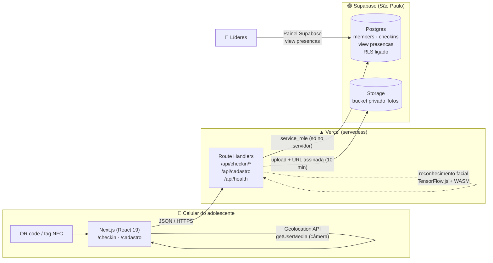
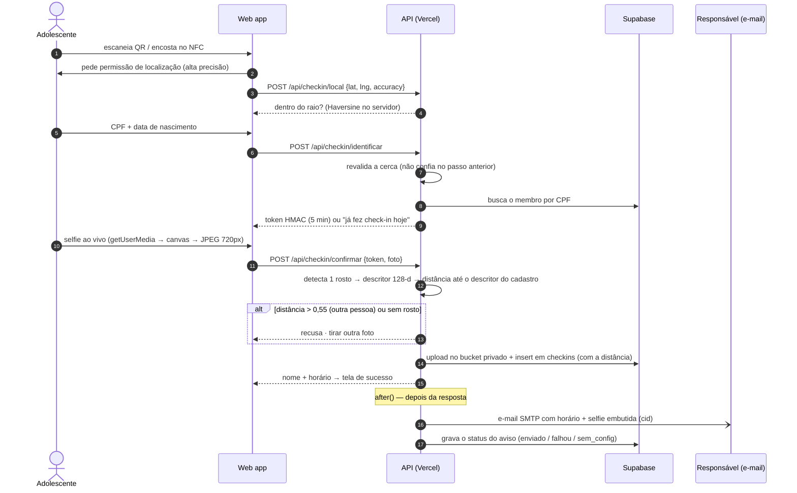

<div align="center">


# Flag Check-in

**Check-in antifraude para o ministério de adolescentes de uma igreja: QR code ou NFC → geolocalização → CPF → selfie.**

Ministério **Flag** · Juventude **O2** — Igreja Batista Capital, Brasília

[](https://github.com/pedroeduardo36/flag-checkin/actions/workflows/ci.yml)


[**▶ Abrir o app**](https://flag-checkin.vercel.app/checkin) · [QR code para imprimir](https://flag-checkin.vercel.app/qrcode) · [Guia de instalação](docs/SETUP.md)

<a href="https://flag-checkin.vercel.app/qrcode"></a><br/><sub>Aponte a câmera do celular · em modo teste (sem exigir estar na igreja)</sub>

</div>

---

## O problema

A cada culto, dezenas de adolescentes chegam ao mesmo tempo. A lista de presença no papel é lenta, fácil de fraudar
("assina por mim?") e não diz nada aos líderes sobre frequência ou sobre quem parou de vir. Os responsáveis também
querem saber se o filho chegou.

## A solução

Um **web app mobile-first**, sem instalar nada. Na porta há um QR code e uma tag NFC. O adolescente encosta o
celular e o check-in leva cerca de 15 segundos:

| 1. Localização | 2. Identificação | 3. Confirmação | Fora do raio | Cadastro |
| :-: | :-: | :-: | :-: | :-: |
|  |  |  |  |  |

| E-mail para o responsável |
| :-: |
|  |

E o responsável recebe na hora um **e-mail com o horário e a foto do check-in**.

Três fatores tornam a fraude cara:

1. **Onde você está:** cerca geográfica (*geofence*) de 150 m ao redor da igreja, validada **no servidor**.
2. **Quem você é:** CPF e data de nascimento conferidos com o cadastro.
3. **Que é você mesmo:** selfie tirada **ao vivo** pela câmera frontal e comparada por **reconhecimento facial** com a
   foto do cadastro. Se não for a mesma pessoa, o check-in é recusado.

---

## Arquitetura



**Decisões e por quê**

| Decisão | Motivo |
| --- | --- |
| **Web app, não app nativo** | Ninguém instala app para entrar no culto. QR e NFC abrem uma URL, e o navegador já oferece GPS e câmera. |
| **Next.js com Route Handlers** | Front e API num repositório só, um deploy só e tipos compartilhados (`lib/format.ts` roda no cliente **e** no servidor). |
| **O navegador nunca fala com o banco** | Toda leitura e escrita passa pela API com a chave `service_role`. O banco tem RLS ligado e **nenhuma** política pública: a chave `anon` vazada não lê nada (isso foi testado). |
| **Supabase em vez de Firebase/Neon** | Postgres de verdade (constraints, views, migrations SQL) **e** armazenamento de arquivos no mesmo plano grátis. Região `sa-east-1`, perto dos usuários e alinhada à LGPD. |
| **Token HMAC sem estado entre as etapas** | A etapa "CPF ok" emite um token assinado de 5 minutos que a etapa "selfie" exige. Assim não há sessão, cookie nem tabela extra, e cabe bem num ambiente serverless. |
| **Unicidade no banco, não no código** | `unique (member_id, service_date)` garante um check-in por dia mesmo com dois cliques simultâneos (corrida tratada pelo código `23505`). |
| **Reconhecimento facial no servidor** | face-api (TensorFlow.js) com backend **WebAssembly**: roda dentro da função serverless, sem GPU, binário nativo nem API paga. No navegador seria fácil de burlar; no servidor, a decisão é da API. |
| **Descritor guardado, não comparado na foto** | No cadastro é salvo um vetor de 128 números do rosto. No check-in só a selfie é analisada (cerca de 250 ms). Cadastros antigos ganham o descritor na primeira vez. |
| **E-mail ao responsável com `after()`** | O envio SMTP roda **depois** da resposta (`next/server` `after`). O adolescente vê a tela de sucesso na hora, e uma falha no e-mail não desfaz o check-in. O resultado fica gravado (`enviado`, `falhou`, `sem_email`, `sem_config`) e aparece na lista de presença. |
| **Foto embutida (CID), não link** | A selfie vai como anexo *inline*. Não depende de URL assinada (que expira) nem de bucket público, e aparece direto no Gmail ou Outlook. |
| **SMTP, não SDK de um fornecedor** | Nodemailer funciona com Gmail, Brevo ou Resend só trocando variáveis de ambiente. |
| **Data do culto em `America/Sao_Paulo`** | Um culto às 22h em Brasília já é o "dia seguinte" em UTC. O fuso é explícito e coberto por teste. |

## Fluxo do check-in



O cadastro (`/cadastro`) segue o mesmo padrão: validação no cliente para dar resposta rápida, **a mesma validação
repetida no servidor**, liberação só com a **senha do fiscal** e a foto precisa ter **exatamente um rosto**.

### Reconhecimento facial

| Etapa | Modelo | O que faz |
| --- | --- | --- |
| Detecção | SSD MobileNet v1 | encontra os rostos e devolve a caixa e a confiança |
| Alinhamento | 68 landmarks | posiciona olhos, nariz e boca para normalizar o rosto |
| Descritor | FaceRecognitionNet (ResNet-34) | gera um vetor de 128 números por rosto |
| Comparação | distância euclidiana | mesma pessoa se ≤ **0,55** (configurável em `FACE_MATCH_THRESHOLD`) |

Regras: sem rosto → recusa; um segundo rosto com mais de 50% do tamanho do principal → "mais de uma pessoa" (rostos
pequenos ao fundo são tolerados); rosto com menos de 15% da largura da foto → "aproxime o celular".

Calibração com rostos sintéticos: **0,35** para a mesma pessoa (espelhada, girada e mais escura) contra **0,76 a 0,82**
para pessoas diferentes.

---

## Design

- **Identidade a partir do logo:** o azul `#008EC3` foi tirado do logo do Flag por análise de pixels. As listras do
  cabeçalho repetem a bandeira do logo.
- **Hierarquia de marca pedida pelo ministério:** **FLAG** em destaque (900, 44px) e "Juventude **O2**" como apoio.
- **Mobile-first de verdade:** botões de 54px, inputs de 17px (abaixo de 16px o iOS dá zoom ao focar),
  `inputMode="numeric"` no CPF e `type="date"` nativo para a data.
- **Uma decisão por tela** e barra de progresso em 4 etapas, para quem está na fila e com pressa.
- **Erros que dizem o que fazer:** localização negada vira um passo a passo para iPhone e Android; GPS impreciso
  sugere ligar a *Localização Precisa*; CPF não encontrado oferece o link do cadastro.
- **Câmera com guia oval** e *fallback* para `<input capture="user">` quando o navegador bloqueia `getUserMedia`.
- **Acessibilidade:** `role="alert"` nas mensagens de erro, `aria-label` no progresso e respeito a
  `prefers-reduced-motion`.

## Segurança e privacidade (dados de menores)

| Ameaça | Mitigação |
| --- | --- |
| Check-in de casa | Cerca geográfica validada **no servidor**, duas vezes. A selfie fica como prova para auditoria. |
| "Faz o check-in por mim" | Selfie comparada por reconhecimento facial com o cadastro (403 se for outra pessoa). A distância fica gravada para auditoria. |
| Injeção de HTML no e-mail | Nome e responsável vêm do cadastro e são escapados antes de entrar no HTML (teste cobre `<b>`). |
| Cadastro com foto de qualquer coisa | A foto do cadastro precisa ter exatamente um rosto, verificado no servidor. |
| Descobrir quem está cadastrado | CPF inexistente e data errada recebem **a mesma** resposta (sem *user enumeration*). |
| Pular a etapa de identificação | A selfie só é aceita com um token HMAC-SHA256 válido, de 5 minutos e comparado em tempo constante. |
| Cadastro por terceiros | Senha do fiscal conferida no servidor com `timingSafeEqual`. |
| Vazamento de chave pública | RLS sem políticas: a chave `anon` não lê nem grava nada (teste: `[]` e `401`). |
| Fotos expostas | Bucket **privado**, com limite de 2 MB e só MIME de imagem. Acesso por URL assinada de 10 minutos. |
| Upload malicioso | `decodePhoto` aceita apenas `data:image/jpeg;base64` entre 2 KB e 2 MB, decodificado por um leitor JPEG em JavaScript puro. |
| Segredo no cliente | `import "server-only"` em `lib/server/*`: o build falha se algo do servidor for importado no navegador. |
| LGPD (art. 14, menores) | Consentimento do responsável obrigatório e gravado com data (`guardian_consent_at`), e coleta mínima. |

Também foram adicionados os cabeçalhos `Permissions-Policy` (câmera e GPS só na própria origem),
`X-Content-Type-Options` e `Referrer-Policy`.

**Limitações assumidas:** apps de GPS falso existem, e por isso a selfie é a segunda camada. O reconhecimento facial não
tem prova de vida (*liveness*): mostrar uma foto impressa da pessoa para a câmera ainda passaria. O próximo passo seria
pedir um movimento, como piscar ou virar o rosto. Ainda não há limite de
tentativas por IP; o próximo passo seria o Upstash Ratelimit nas rotas de identificação.

## Testes

```bash
npm test             # 37 testes unitários (Vitest): CPF, máscaras, datas, Haversine, token HMAC, geofence, upload, rostos, e-mail
npm run typecheck    # TypeScript em modo strict
npm run test:fluxo   # 20 verificações ponta a ponta contra o Supabase real, com limpeza dos dados no final
```

O **teste ponta a ponta** cobre o caminho feliz **e** os ataques: senha de fiscal errada (401), CPF duplicado (409),
posição fora do raio (403), data de nascimento errada (404), segundo check-in no mesmo dia (409), acesso à selfie por
URL assinada e o registro aparecendo na view de presença. Também cobre o reconhecimento facial: cadastro sem rosto e
com duas pessoas (422), selfie de **outra pessoa** (403) e selfie da **mesma pessoa** em outro ângulo e luz (200).

As imagens de teste em `tests/fixtures/` são **rostos sintéticos** gerados por StyleGAN2 (thispersondoesnotexist.com):
nenhuma pessoa real aparece no repositório.

A esteira de **CI no GitHub Actions** roda tipos, testes e build a cada push e PR.

## Stack

**Front:** Next.js 15 (App Router) · React 19 · TypeScript strict · CSS puro com design tokens (sem framework de UI)
**Back:** Route Handlers serverless · `node:crypto` (HMAC e comparação em tempo constante) · Supabase JS
**E-mail:** Nodemailer (SMTP) · HTML responsivo em tabelas (compatível com Gmail e Outlook) · imagem inline via CID
**Visão computacional:** face-api (TensorFlow.js 4, backend WebAssembly) · SSD MobileNet v1 · FaceRecognitionNet · jpeg-js
**Dados:** Postgres 17 (Supabase) · migrations versionadas com o Supabase CLI · Storage privado
**Infra:** Vercel · GitHub Actions · QR code gerado no servidor (`/api/qrcode`) · tags NFC NTAG213

## Estrutura

```
app/
  checkin/page.tsx            máquina de estados do check-in (boot → local → dados → selfie → sucesso)
  cadastro/page.tsx           cadastro com consentimento LGPD e senha do fiscal
  api/checkin/local           GET: modo teste? · POST: confere a cerca
  api/checkin/identificar     CPF + nascimento → token HMAC
  api/checkin/confirmar       selfie → Storage + insert
  api/cadastro                novo adolescente
  api/health                  diagnóstico (variáveis, tabelas, view e bucket)
  api/qrcode · qrcode/        QR code gerado no servidor (PNG/SVG) e página para imprimir
components/                   Brand (marca), Camera (getUserMedia + fallback)
lib/format.ts                 validações compartilhadas cliente/servidor
lib/server/                   env, cliente Supabase, segurança, reconhecimento facial, tratamento de erros
supabase/migrations/          schema, RLS, view de presença e bucket
scripts/                      gerador de QR code e teste ponta a ponta
tests/                        testes unitários (Vitest) e rostos sintéticos de teste
```

## Rodando localmente

```bash
git clone https://github.com/pedroeduardo36/flag-checkin.git && cd flag-checkin
npm install
cp .env.example .env.local     # preencha com seu projeto Supabase
npx supabase link --project-ref SEU_REF && npm run db:push
npm run dev
```

O passo a passo completo (Supabase, Vercel, QR code, NFC e operação no dia do culto) está em
[docs/SETUP.md](docs/SETUP.md).

---

<div align="center">
Feito por <a href="https://github.com/pedroeduardo36">Pedro Andrade</a> para o Ministério Flag · Juventude O2
</div>
